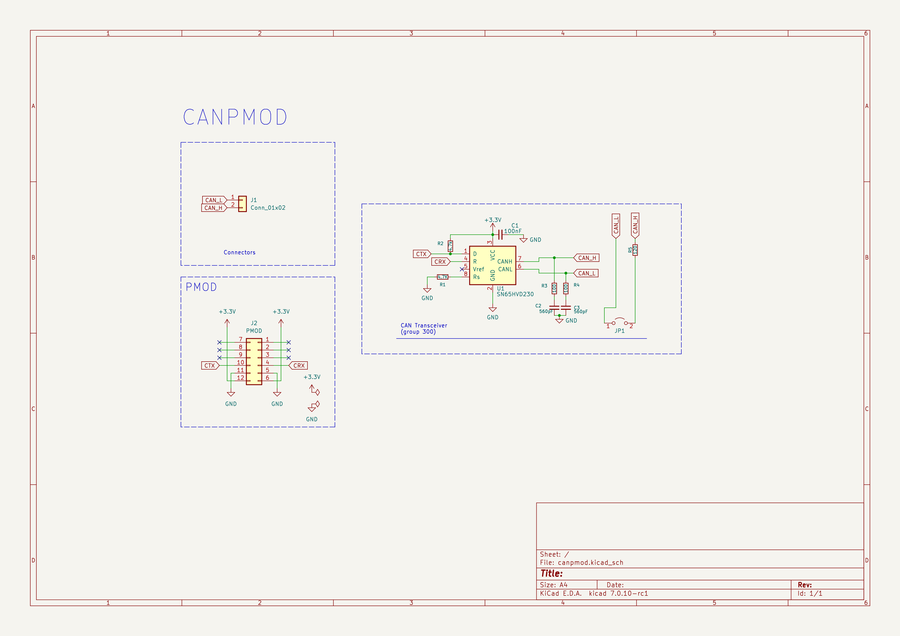

# CAN PMOD

CAN PMOD is a 3.3 V SN65HVD230 CAN transceiver module, based on the
[Waveshare SN65HVD230 CAN board](https://www.waveshare.com/sn65hvd230-can-board.htm/).
The host must provide the CAN protocol controller.

The project is **KiCad 9.0.8**. Open [kicad/canpmod.kicad_pro](kicad/canpmod.kicad_pro).
The two-layer, 1.6 mm board has 12 components and keeps its original outline
and component placement.

This revision corrects the PMOD footprint's physical numbering, reroutes the
affected nets, adds local connector footprints, and refreshes silkscreen and
library symbols. ERC reports 0 errors and 0 warnings. DRC with schematic
parity reports 0 violations and 0 unconnected items.

The photographs above show the original board. They remain in `img/` as
historical images.

## PMOD connections

**J2** is the right-angle male PMOD header. Viewed from the PCB top with its
plug pointing left, pins 1–6 run top to bottom in the inboard row; pins 7–12
run top to bottom in the outboard row. Pin 1 is square and marked on silkscreen.

| PMOD pin | Signal | Function |
| --- | --- | --- |
| 1 | NC | Unconnected |
| 2 | NC | Unconnected |
| 3 | NC | Unconnected |
| 4 | CAN RX | CAN receive (input to host) |
| 5 | GND | Ground |
| 6 | 3.3 V | Supply from host |
| 7 | NC | Unconnected |
| 8 | NC | Unconnected |
| 9 | NC | Unconnected |
| 10 | CAN TX | CAN transmit (output from host) |
| 11 | GND | Ground |
| 12 | 3.3 V | Supply from host |

**J1** is the 5.08 mm-pitch CAN terminal: pin 1 CAN_L, pin 2 CAN_H.
**JP1** enables the 120 Ω termination when a shunt is fitted.

R1 is the 4.7 kΩ slope-control resistor. R2 pulls TX high. C1 is the 100 nF
supply bypass. R3/C2 and R4/C3 are 100 Ω / 560 pF series RC branches from each
bus line to ground.

## Files in this revision

| Path | Role |
| --- | --- |
| [kicad/canpmod.kicad_pro](kicad/canpmod.kicad_pro) | KiCad 9 project |
| [kicad/canpmod.kicad_sch](kicad/canpmod.kicad_sch) | Schematic |
| [kicad/canpmod.kicad_pcb](kicad/canpmod.kicad_pcb) | Board |
| [kicad/fp-lib-table](kicad/fp-lib-table) | Local footprint table (`${KIPRJMOD}`) |
| [kicad/libs/canpmod.pretty/PMOD_2x06_Horizontal.kicad_mod](kicad/libs/canpmod.pretty/PMOD_2x06_Horizontal.kicad_mod) | Corrected PMOD 2×6 land |
| [kicad/libs/canpmod.pretty/TerminalBlock_bornier-2_P5.08mm.kicad_mod](kicad/libs/canpmod.pretty/TerminalBlock_bornier-2_P5.08mm.kicad_mod) | 5.08 mm CAN terminal land |
| [kicad/output_files/BOM-canpmod.csv](kicad/output_files/BOM-canpmod.csv) | BOM, 12 components |
| [kicad/output_files/CPL-canpmod.csv](kicad/output_files/CPL-canpmod.csv) | Pick-and-place |
| [kicad/output_files/gerbers/](kicad/output_files/gerbers/) | Gerbers and drill for this board |

`kicad/output_files/GERBER-canpmod.zip` is the earlier KiCad 7 Gerber package.
Use the `gerbers/` directory for the KiCad 9 board.

J2 needs a manufactured right-angle 2×6 header matched to the footprint.
Exact connector MPNs, passive ratings, assembler acceptance, and bench
validation remain open. Clean ERC/DRC is not fabrication approval.

License: [MIT, copyright 2024 disdi](LICENSE).
